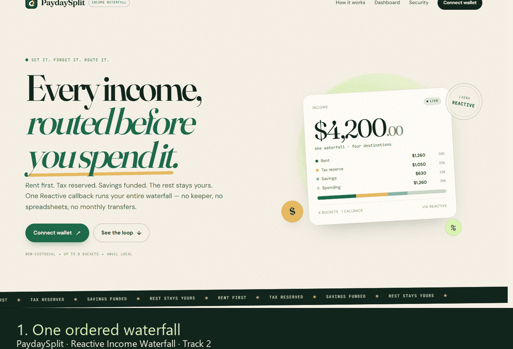
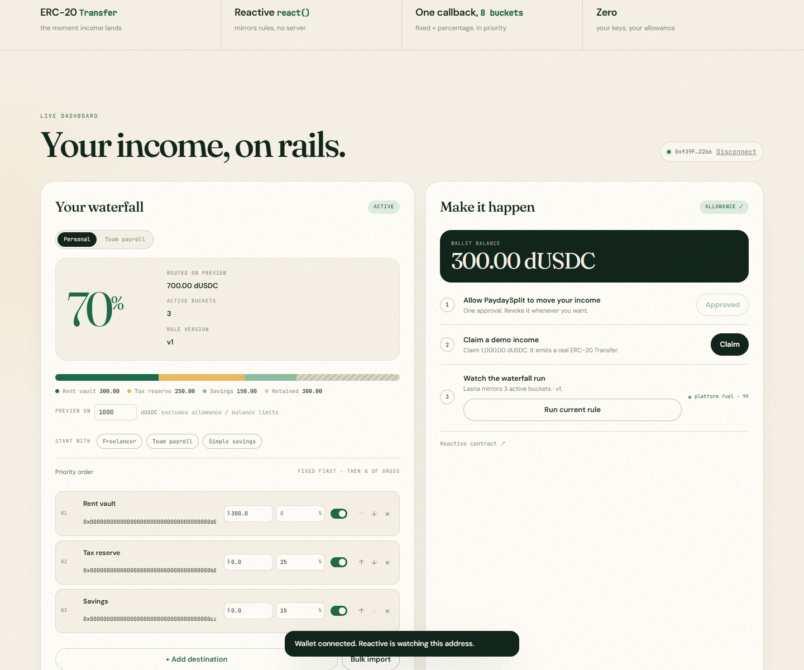
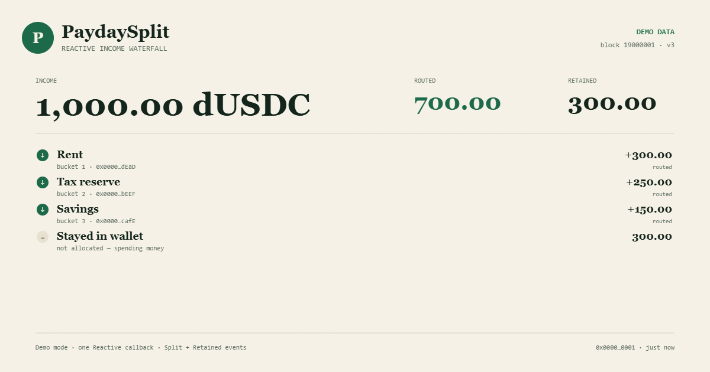

# PaydaySplit — Reactive Income Waterfall

> **Rent first. Tax reserved. Savings funded. The rest stays yours.**
>
> Reactive Omni Buildathon · Track 2 — *Set It and Forget It*

## 学习记录 · 2026-11-17

本仓库记录 Reactive Omni 收入分账项目的实现、测试和学习笔记。

- **Omni 实现**：使用 `reactive-lib-omni`、`onlySystem` 和 `SYSTEM.requestCallbackV_1_0`；回调首参数保留 `address(0)`，由网络注入 Reactive 合约地址。
- **费用机制实测**：[Lasna 三参数查询与三问回答](docs/LASNA-FEES-NOTE.md)，附 [cast 原始输出](deployments/lasna-fees.json)。
- **项目实践**：[v5 功能与验收记录](docs/UPGRADE-v5.md)、[测试复现方法](docs/TESTING.md)、[本地完整流程证据](deployments/31337.evidence.json)。
- **当前进度**：本地验证已完成；真实测试网部署与外部审计待完成。





*Waterfall dashboard on local Anvil: 70% routed on the preview, 300 retained, activity grouped by run.*



> **v5 update (2026-11-17):** wallet reserves, per-run / daily spending caps, expiry, pause, bounded approvals and replay-safe recovery. See [upgrade and validation notes](docs/UPGRADE-v5.md). Existing screenshots/video show the earlier UI.

## English quick read

**PaydaySplit is a non-custodial income waterfall.** Every payment in a configured ERC-20 is routed by priority in one Reactive callback: the default preset puts fixed bills first (rent, salaries), then percentage buckets (tax, savings, bonus), and the remainder stays in the wallet. Up to 8 buckets, versioned rules, per-bucket failure isolation, and a manual recovery path.

- **62 Foundry tests**, including fuzz preview-vs-execution, malicious/non-standard ERC-20s, replay, version monotonicity, and per-user callback budgets.
- **Local Anvil full loop is verified** — see `deployments/31337.evidence.json`; **testnet is not deployed yet** (requires your wallet/funds).
- **No-wallet demo:** `cd web && npm install && npm run dev`, then open `/?demo=1`.
- **Local full loop:** `pwsh ./script/local-demo.ps1`; with MetaMask, also run `cd web && npm run local:watch`.
- **Video:** `docs/payday-split-demo.mp4` (2:57, local Anvil; Chinese narration + English subtitles).
- **Shareable receipt:** each run has a **Receipt** button that downloads a 1200×630 PNG (income, buckets, retained, tx hash) for a submission card or social post.

| Evidence | Status |
|---|---|
| Contracts + 62 tests | ✅ local; CI workflow included |
| Local Anvil end-to-end (Transfer → react → callback → Split/Retained) | ✅ verified |
| Demo mode / judge quick path | ✅ `?demo=1` |
| Sepolia + Lasna deployment | ⏳ needs funded test wallet (see `docs/REMAINING_TASKS.md`) |
| Public GitHub | ✅ https://github.com/louisluo0301-cell/payday-split |
| DoraHacks submission | ⏳ pending |

> Fixed amounts and percentages are **additive per bucket**; array order is the priority. The UI ships a fixed-first Freelancer preset.

---

PaydaySplit 不再只是「工资自动存钱」，而是一个**收入分账引擎**：配置 token 的每一笔收入到账时，按你设定的优先级依次执行固定账单、百分比预留和储蓄，剩余部分留在钱包里消费。整条 waterfall 由 Reactive Network 监听 `Transfer` 事件触发，**一次回调完成最多 8 笔转账**。

- 合约：Solidity `0.8.29`，Foundry，`reactive-lib-omni v0.1.0`
- 规则：固定金额 + 百分比 + 优先级 + 版本号；最多 8 个去向
- 前端：Vite + ethers v6，可视化 waterfall 编辑器
- 测试：**62 个 Foundry 测试全部通过**（含 fuzz）
- 本地全链路：Anvil + MockSystem + MockProxy 实测通过

---

## 1. 为什么需要它

自由职业者、创作者、小团队的收入是**不规律**的：客户回款、平台结算、DAO 拨款，金额和时间都不固定。每次到账都要手动做一遍：

- 先留房租 / 固定账单；
- 再预留 20–30% 的税；
- 再存一部分；
- 剩下的才是可消费的钱。

手动做，迟早会漏；用 keeper 机器人，要维护服务器、私钥和账单；用交易所自动划转，又不透明。

PaydaySplit 把这件事变成一条**有序的 waterfall**：你设置一次，之后每笔收入到账，链上自动按优先级执行。

---

## 2. 它怎么工作

### 2.1 一条 waterfall

每个用户、每个 token 维护一个有序 bucket 列表：

```solidity
struct Bucket {
    address payee;       // 收款方
    uint96 fixedAmount;  // 固定金额（与百分比相加，按数组顺序执行）
    uint16 bps;          // 毛收入的百分比
    bool active;
}
```

数组顺序就是优先级。执行时：

```
remaining = paycheck
for bucket in buckets (按顺序):
    requested = fixedAmount + paycheck * bps / 10000
    pay = min(requested, remaining)
    如果余额/授权足够：transferFrom(user → payee, pay)
    remaining -= pay
剩余 remaining 留在用户钱包
```

### 2.2 一个具体例子

收入 **1,000 USDC**：

| 优先级 | 去向 | 规则 | 实付 |
|---|---|---|---|
| 01 | 房租 | 固定 300 | 300 |
| 02 | 税 | 25% | 250 |
| 03 | 储蓄 | 15% | 150 |
| — | 消费 | 剩余 | **300** |

一次 `Transfer` 事件 → local `react()` (MockSystem) → 一次目标链回调 → 3 笔转账 + 1 条 `Retained` 事件。

### 2.3 团队工资模式

同一套合约，把「用户」换成团队金库即可：

- 固定 bucket 1：设计师 1,500 USDC；
- 固定 bucket 2：开发 2,000 USDC；
- 固定 bucket 3：运营 800 USDC；
- 百分比 bucket：奖金池 10%。

金库收到回款后，一次回调把工资全部发出去。团队金库可以是一个 Safe / 多签，只需要给 `PaydaySplit` 授权。

### 2.4 规则版本

每次 `setBuckets` 都会把 `ruleVersion[user][token]` 加一。Reactive 合约把版本一起镜像，并在回调 payload 里带上版本。目标链执行时如果版本不一致，会发出 `StaleRule` 并拒绝执行——**旧回调不会套用新规则**。

---

## 3. 架构

```
                        ┌────────────────────────────────────┐
   ① 收入到账            │  ② Lasna: PaydaySplitReactive       │
   Sepolia / Base        │                                    │
   ┌──────────────┐      │  subscribe(BucketsSet)             │
   │ USDC / dUSDC │─────▶│  subscribe(Transfer, to=you)       │
   │ Transfer     │event │  react(): 镜像 buckets + version    │
   └──────┬───────┘      └───────────────┬────────────────────┘
          │                              │ requestCallbackV_1_0
          │                              ▼
          │                ┌────────────────────────────────────┐
          │                │ ③ Callback Proxy (目标链)           │
          │                └───────────────┬────────────────────┘
          │                                │ executeSplit(..., version)
          ▼                                ▼
   ┌──────────────────────────────────────────────────────────┐
   │  PaydaySplit (目标链)                                     │
   │  - 有序 bucket 列表 + 版本号                               │
   │  - 双重鉴权：Proxy + Reactive 地址                         │
   │  - 固定金额优先，再按毛收入百分比                          │
   │  - 每个 bucket 独立失败隔离；剩余 Retained                 │
   └──────────────────────────────────────────────────────────┘
```

Reactive 侧通过 `BucketsSet` 事件镜像规则，并**动态订阅**该用户的 `Transfer(to=user)`。用户把 bucket 全部关掉时，Reactive 自动退订。

---

## 4. 仓库结构

```
payday-split/
├── src/
│   ├── PaydaySplit.sol            # 目标链：bucket 列表 + waterfall + 版本
│   ├── PaydaySplitReactive.sol    # Lasna：镜像、动态订阅、回调
│   └── DemoUSDC.sol               # 6 位小数演示稳定币
├── test/
│   └── PaydaySplit.t.sol          # 62 tests + MockSystem / MockProxy
├── script/
│   ├── Deploy.s.sol               # 4 步部署 + 默认 Freelancer waterfall
│   ├── deploy.ps1 / deploy.sh     # 一键部署
│   ├── verify.ps1 / verify.sh     # 链上证据
│   └── local-demo.ps1             # 一键本地全链路
├── web/
│   ├── index.html                 # 落地页 + waterfall dashboard
│   ├── src/main.js                # bucket 编辑器、规则保存、活动流
│   ├── src/style.css
│   └── script/local-watcher.mjs   # 本地模拟 Reactive
├── docs/
│   ├── ARCHITECTURE.md
│   ├── SECURITY.md
│   ├── DEMO.md
│   ├── DEPLOY.md
│   ├── SUBMISSION.md
│   └── COMMUNITY_TASKS.md
└── foundry.toml
```

---

## 5. 本地快速开始

### 5.1 合约测试

```bash
forge test -vv
```

覆盖：

- 构造时订阅 `BucketsSet`
- bucket 镜像 + 动态订阅 `Transfer`
- 固定 + 百分比 + 优先级
- 部分支付 / 余额不足 / 授权不足
- 单个 bucket 失败不影响其他
- 版本过期回调
- 重复回调
- 全部关闭自动退订
- 8 个上限、100% 上限、非法 payee
- `previewWaterfall` 与真实执行 fuzz 对齐
- false-return / USDT-style no-return / malformed-return token
- 相同规则重存不 bump version
- 镜像版本单调、per-user callback budget、min paycheck
- 手动 `runSplit` 恢复路径
- pause / 权限 / fuzz

### 5.2 前端

```bash
cd web
npm install
npm run dev
```

- **No wallet, no chain:** open `http://127.0.0.1:5173/?demo=1` — prefilled sample run, editable rule, CSV export.
- **Full local loop:** run `pwsh ./script/local-demo.ps1`, open `http://127.0.0.1:5173/?local=1`, and in a second terminal `cd web && npm run local:watch` (auto-delivers callbacks while MetaMask is connected).
- **Testnet:** no query parameter; reads `web/public/deployments.json`; connect the wallet that owns the rule.

### 5.3 一键本地全链路

```powershell
pwsh ./script/local-demo.ps1
```

脚本会重置 Anvil、部署 `MockSystem`/`MockProxy`/`DemoUSDC`/`PaydaySplit`/`PaydaySplitReactive`，设置默认 Freelancer waterfall，跑一笔 1,000 dUSDC 收入，并写出 `deployments/31337.evidence.json`。

本地结果（最新一次）：

| 环节 | 交易 |
|---|---|
| 收入 `Transfer` | `0xaed7e751162d6ec123fa40ed5c2ac4c0c075dcbc419ccafaf9eeaf5694568503` |
| local `react()` (MockSystem) | `0xa1cdef5cb90f3c241b52d068afd592bf13abd03d220a969855b450f7a04ff456` |
| 回调 / `Split` + `Retained` | `0xbcda62fcdd1679d2929f137649ceabbec16d58cf37a5eb92786dc8e05af574dc` |
| 结果 | 房租 300 / 税 250 / 储蓄 150 / 留存 300 |

> 这些是本地 Anvil 交易，不是测试网交易，不能当作 Sepolia 证据提交。

---

## 6. 测试网部署

### 6.1 准备

1. 新建一次性测试钱包；
2. 领 Sepolia / Base Sepolia ETH；
3. 用 0.01 ETH 换 lREACT：
   - Sepolia faucet：`0x9b9BB25f1A81078C544C829c5EB7822d747Cf434`
   - Base Sepolia faucet：`0x2afaFD298b23b62760711756088F75B7409f5967`
4. `cp .env.example .env`，填 `PRIVATE_KEY`。

### 6.2 一键部署

```powershell
pwsh ./script/deploy.ps1
# 或
bash script/deploy.sh
```

默认会创建一个 3-bucket Freelancer waterfall：

- 房租：固定 300 USDC → `RENT_PAYEE`
- 税：25% → `TAX_PAYEE`
- 储蓄：15% → `SAVINGS_PAYEE`

可以在 `.env` 里改，部署后也可以在前端改。

### 6.3 验证

```powershell
pwsh ./script/verify.ps1
```

会打印：源链 `Transfer`、Lasna 的 `getRule`、目标链的 `bucketCount`/`ruleVersion`/`getBuckets`、最近的 `Split` 与 `Retained` 日志。

---

## 7. 已部署地址

> 当前状态：本地 Anvil demo 已完成；测试网部署按本次交付选择暂缓。运行 `script/deploy.ps1` 后把下面替换为真实地址。

| 网络 | 合约 | 地址 |
|---|---|---|
| Sepolia (11155111) | DemoUSDC | `TBD` |
| Sepolia (11155111) | PaydaySplit | `TBD` |
| Lasna (5318007) | PaydaySplitReactive | `TBD` |
| Sepolia (11155111) | Callback Proxy | `0xAa14d9Cd0f788Ca23d11805986C1d8bd035D23b4` |

---

## 8. 安全设计

- **非托管**：合约从不持有本金，只在用户授权额度内 `transferFrom`。
- **双重回调鉴权**：`msg.sender == Callback Proxy` 且注入地址 `== reactive`。
- **100% 上限**：所有 active bucket 的 bps 之和 ≤ 10,000；固定金额也受 paycheck 上限约束。
- **优先级**：数组顺序就是优先级（默认 preset 把固定账单放前面）；余额不足时按顺序部分支付；后面的 bucket 自动跳过。
- **失败隔离**：单个 bucket 的 allowance / transfer 失败只 emit `BucketSkipped`，不阻断整条 waterfall。
- **版本保护**：`StaleRule` 拒绝旧回调套用新规则。
- **重放保护**：`keccak256(originTxHash, logIndex)` 只执行一次。
- **可撤销**：用户可 `disableAll` / 撤销 allowance；owner 可 pause。

详见 [docs/SECURITY.md](docs/SECURITY.md)。

---

## 9. 赛道匹配（Track 2）

| 评审维度 | PaydaySplit |
|---|---|
| **Execution** | 62/62 Foundry；本地 Anvil 全链路；测试网部署脚本已就绪但**未执行** |
| **Integration** | Reactive 镜像 bucket 列表和版本、动态订阅、一次回调执行 8 个去向 |
| **Usefulness** | 自由职业者/创作者/小团队的「收入分账 + 税预留 + 房租优先」 |
| **Craft** | 两个合约、62 个测试、可视化编辑器、部署/验证/本地演示、架构/安全/演示文档 |

---

## 10. 文档

- [架构与 waterfall 算法](docs/ARCHITECTURE.md)
- [安全模型与已知限制](docs/SECURITY.md)
- [2:57 演示视频（本地 Anvil）](docs/payday-split-demo.mp4)
- [演示视频脚本](docs/DEMO.md)
- [部署手册](docs/DEPLOY.md)
- [DoraHacks 提交草稿](docs/SUBMISSION.md)
- [社区开放任务 5 个方向](docs/COMMUNITY_TASKS.md)
- [Reactive 四问四答图（PNG）](docs/paydaysplit-four-questions.png)
- [一页项目简介（judge quick read）](docs/ONE_PAGER.md)
- [路线图：从 hackathon 到生产](docs/ROADMAP.md)
- [测试与覆盖：62 tests / local evidence](docs/TESTING.md)
- [后续待办：测试网/视频/发布/提交](docs/REMAINING_TASKS.md)

---

## 11. English summary

**PaydaySplit — Reactive Income Waterfall** is a non-custodial income router. Every incoming stablecoin payment is split through an ordered list of up to 8 buckets: the default preset puts fixed bills first (rent, invoices), then percentage buckets (tax, savings, investing), and the remainder stays in the wallet. A Reactive contract on Lasna mirrors the bucket list and its version, subscribes to the user's incoming ERC-20 `Transfer`, and requests one callback that executes the whole waterfall on the destination chain.

- Fixed + percentage buckets, priority order, 100% cap.
- Versioned rules; stale callbacks cannot apply a new rule.
- Per-bucket failure isolation; `Retained` event for spending money.
- 62/62 Foundry tests; local Anvil full-loop demo; testnet deploy scripts ready (not executed).
- Stack: Solidity 0.8.29, Foundry, reactive-lib-omni v0.1.0, Vite + ethers v6.

---

## License

MIT. See [LICENSE](LICENSE).
